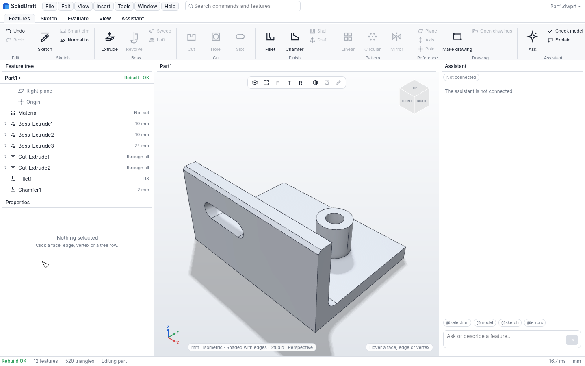

# SolidDraft

A parametric CAD application written in Rust, free for everyone, for ever.

## Why this is free

Nearly every commercial CAD program you can buy runs on one of a handful of closed geometry kernels. Parasolid, ACIS, CGM and a few others sit under SolidWorks, Inventor, Fusion, NX, CATIA and most of the rest. Their owners licence them, meter them and can withdraw them. The maths inside is a century old and the algorithms are published. What is closed is the code, and the code is kept closed by law.

That law is not property. Property exists because things are scarce. If you take my lathe, I no longer have a lathe. If you copy my kernel, I still have my kernel, and now you have one too. Ideas, formulas and programs are not scarce in that sense, so the "intellectual property" over them has to be manufactured by the state: a grant that forbids you from arranging your own bits in a pattern someone else arranged first. Murray Rothbard said it of patents in 1962: "Patents, therefore, are grants of exclusive monopoly privilege by the State" (Man, Economy, and State, ch. 10, sec. 7, Mises Institute edition, https://mises.org/online-book/man-economy-and-state-power-and-market/10-monopoly-and-competition/7-patents-and-copyrights). Rothbard kept copyright as a kind of contract. Stephan Kinsella took the argument the rest of the way: "Ideas are not naturally scarce" (Against Intellectual Property, Journal of Libertarian Studies 15:2, 2001, "Scarcity and Ideas"). We stand with that reading.

Apply it to CAD. Geometry is mathematics and belongs to everyone. A B-rep kernel is a set of theorems with a type system around them. There is no good reason the ground every CAD tool stands on should be owned by three companies and rented to everyone else. A public kernel is the ground a free market in CAD tools can grow on: small vendors, scripts, plug-ins and one-person products that do not have to ask anyone's permission to exist. Closed kernels did not make CAD good. They made it expensive and slow to change.

So this app is public. Free to use, change and share, for good.

## What we are attempting

SolidDraft and Catallax are an attempt to put the strongest AI reasoning available to work on CAD: better modelling tools and a geometry kernel that anyone can study, build and improve. Almost all of the code is written by AI coding agents, directed and reviewed by a human. Whether that approach works at the scale CAD demands is the open question. We will find out in public.

## About the licence

An honest objection: an open-source licence is itself a copyright instrument. You cannot refuse copyright. It attaches to code the moment it is written, whether the author wants it or not. The only way to hand it back is a licence or a waiver, and that document borrows the state's rule to undo the state's rule. We accept that. The licence here does not exist to exclude anyone. It gives away, in writing, every right the law handed us by default, and keeps one thing, the author's name on the work.

Licensed under MIT. The licence is used for one purpose only: to keep the credit line below attached to copies of this work.

Credit: SolidDraft was started by Pedro De Paiva. Keep that line if you copy it.

Check out my other products at [ZigrawBohnBawerick](https://zigrawbohnbawerick.org/).

## Sponsorship

Help fund SolidDraft and Catallax through [GitHub Sponsors](https://github.com/sponsors/BohnBawerick) or [Ko-fi](https://ko-fi.com/pedropaiva56920). Both support the same project, started by Pedro De Paiva.

## What it is

A SolidWorks-style desktop CAD app: a feature tree on the left, an AI assistant on the right, a ribbon of commands on top and a 3D viewport in the middle.

SolidDraft is built for [Catallax](https://github.com/BohnBawerick/catallax) and will run only on it. They are one project in two repositories: SolidDraft is the CAD application and Catallax is its kernel. Today SolidDraft still runs on SMLib through its kernel bridge until the Catallax backend lands. SMLib will then be removed. See the [project website](https://kernel.zigrawbohnbawerick.org/) and the [roadmap](docs/roadmap.md).



## What works today

Work in progress. These features run today on the C++ SMLib kernel from NVIDIA's USD BRep:

- The desktop app, with its ribbon, feature tree, property panel, assistant panel and wgpu viewport.
- Sketching on a plane or a planar face with line, rectangle, circle, arc and slot tools, with relations and dimensions.
- Extrude, cut, fillet and chamfer. References that survive a rebuild or ask to be repaired. Undo and redo. Feature tree editing. Part files.
- Drawings: ISO and ANSI sheets, aligned views, sections, details, auxiliary and broken-out views, ordinate, baseline and chain dimensions, GD&T, datums, surface finish and revision marks. Output to its own drawing file, SVG, PDF and DXF. Drawings pin the part revision they were saved against and can be updated after the part changes.
- The assistant, connected to Claude: it reads the part, proposes changes as cards you preview, apply and undo. The same commands are open to outside agents over MCP.
- A headless command line that replays recipes, rebuilds parts, renders hidden-line views and makes drawings.
- A WebAssembly build that runs the whole app, kernel included, in a browser.

Not yet: the Catallax backend, STEP, IGES and mesh import and export, surfacing and sheet metal. Assemblies are in progress. Only drawings can be exported today. The [roadmap](docs/roadmap.md) orders the remaining work and names the kernel stages that features will wait for when SMLib goes.

## Building

You need Rust 1.95 or later and a C++17 compiler. The kernel source is a git submodule:

```sh
git submodule update --init third_party/usd-brep
cargo build --release
```

The first build compiles SMLib, which takes several minutes.

## Running the app

```sh
cargo run --release -p soliddraft-app -- --demo
```

A part or drawing file on the command line opens it. `--demo` loads a sample part, `--bench` measures frame times on a dense body and exits, `--screenshot out.png` saves the window and exits, `--help` lists the rest. Press `?` in the app for the keyboard shortcuts.

Modelling starts with a sketch: pick a plane in the tree or click a planar face, draw, add dimensions with `D`, then Extrude or Cut from the property panel. Fillet and chamfer take edges clicked in the viewport.

## Running in a browser

The app also runs in a web browser as WebAssembly. A small server serves it and holds the assistant's API key. See `docs/web.md`.

## The assistant

The assistant needs an Anthropic API key, from `ANTHROPIC_API_KEY` or the OS keychain:

```sh
printf %s "$KEY" | cargo run --release -p soliddraft-cli -- key set
```

Without a key the app runs and the chat panel says the assistant is off. `--mcp [PORT]` serves the open part to MCP clients such as Claude Code; `soliddraft mcp` serves a headless part over stdio. See `docs/assistant.md`.

## Command line

```sh
cargo run --release -p soliddraft-cli -- replay --steps recipes/union.json
cargo run --release -p soliddraft-cli -- view recipes/bracket.json --dir front,top,right,iso --svg 'bracket-{view}.svg'
cargo run --release -p soliddraft-cli -- part bracket.dwprt
cargo run --release -p soliddraft-cli -- draw recipes/bracket.json --template iso-a3
```

Replay prints each step's face, edge and vertex counts, volume, area, validity and a geometric digest. View writes hidden-line views. Part rebuilds a saved part and prints every feature's state. Draw makes a full drawing of a recipe's result. Each subcommand has `--help`.

## Tests

```sh
cargo test --workspace
```

The app's exit tests drive the real interface through `egui_kittest` on wgpu and skip themselves on a machine with no GPU adapter.

## Contributing

Pull requests are welcome. Read `docs/DESIGN.md` for the app's interface to the kernel and `docs/modelling.md` for the document model before changing either. Keep the kernel behind its interface; nothing in the app may depend on SMLib directly. Run `cargo fmt --all --check`, `cargo clippy --workspace --all-targets -- -D warnings` and `cargo test --workspace` before you open a pull request. Agent-written code is fine and expected; say so in the pull request, and stay accountable for what it does.

If a change needs a new kernel operation, describe it in an issue before changing the bridge.

## Licence and credit

Licensed under MIT. See `LICENSE` and `NOTICE`.

The SMLib kernel is NVIDIA's, under Apache-2.0, compiled unmodified from USD BRep release 1.0.0 and included as a git submodule with its own notices. The bundled Inter font is under the SIL Open Font License 1.1.

SolidDraft is not affiliated with, sponsored by or endorsed by Dassault Systèmes, Autodesk, Siemens or NVIDIA. SolidWorks, DraftSight, Parasolid and the other names above are their owners' marks.

Started by Pedro De Paiva. Written with AI coding agents.
